# High-Performance Cross-Platform Async Logger

English | [简体中文](README.zh-CN.md)

> A C++17 asynchronous logging library for services: the business thread only writes to memory and never touches the disk, while compression, encryption, and persistence all happen in the background. Every chunk is checksummed and end-to-end encrypted, and can be restored offline with the bundled decoder.


## Design goals

| Goal | Approach |
| --- | --- |
| No disk I/O on the hot path | Producers only format and append to memory; compression, encryption, and disk writes run in a background executor |
| Never block the business thread | Master/slave double buffering over mmap, swapped atomically when utilization hits a threshold |
| Scales with threads | Per-thread compressor instances via `Clone()`, `thread_local` scratch buffers, minimal critical section |
| Predictable on-disk footprint | Per-record streaming compression (Zstd / Zlib), optional trained dictionary for small records |
| No plaintext at rest | ECDH key agreement per chunk + AES payload encryption; the private key only exists on the decoder side |
| Identical behavior across platforms | POSIX / Win32 abstraction for mmap, file system, and system utilities |

## Features

- **Asynchronous, non-blocking writes** — producers only format and append to an mmap-backed cache; a background executor performs compression, encryption, and disk I/O.
- **Double-buffered mmap persistence** — master/slave caches are swapped when the master reaches a configurable utilization threshold, so writing continues while the slave is flushed to disk.
- **Scales with threads** — compression and encryption no longer share a global lock; each thread clones its own compressor, lifting 8-thread throughput ~1.8× and cutting P99 from milliseconds to hundreds of microseconds.
- **Streaming compression** — per-record streaming compression with Zstd or Zlib; compression contexts and input/output buffers are reused.
- **Optional dictionary compression** — point `Conf::dict_path` at a trained zstd dictionary to fix on-disk bloat for small records.
- **End-to-end encryption** — ECDH key agreement per chunk + AES for record payloads. The private key never leaves the decoder side.
- **Protobuf record encoding** — structured fields (level, timestamp, pid, tid, file, function, line, message) are serialized with a custom `.proto` schema, enabling custom output formats at decode time.
- **Pluggable architecture** — sinks, formatters, compressors, and cryptors are all behind abstract interfaces.
- **Log rotation and retention** — rotate by file size, evict oldest files when the total directory size exceeds the budget (always keeping the newest), and clean up periodically.
- **Compile-time level stripping** — disabled log levels expand to `(void)0`, producing zero runtime overhead.
- **Cross-platform** — POSIX and Win32 abstraction layers for mmap, file system, and system utilities.
- **Offline decoder** — convert binary log files back into human-readable text with a configurable format pattern and an optional dictionary.

## Architecture

```mermaid
flowchart LR
    A["Application<br/>EXT_LOG_INFO(...)"] --> B["Formatter<br/>LogMsg -> EffectiveMsg"]
    B --> C["Compression<br/>Zstd / Zlib (streaming)"]
    C --> D["Encryption<br/>ECDH + AES"]
    D --> E["mmap master cache"]
    E -->|"swap when threshold reached"| F["mmap slave cache"]
    F --> G["Background executor<br/>thread pool"]
    G --> H["Log files<br/>rotation + retention"]
    H --> I["decode tool<br/>+ server private key"]
    I --> J["Plain-text logs"]
```



Write path in detail:

1. `EXT_LOG_*` macros / `LogHandle::Log` filter by level and format the message with `fmt`.
2. `EffectiveSink` serializes the record with Protobuf, compresses it with the streaming compressor, and encrypts it with the AES key derived from ECDH.
3. The encrypted record is appended to the mmap **master cache** as `ItemHeader + payload`.
4. When the master cache exceeds the utilization threshold, master and slave are swapped, and the background executor writes the slave to disk.
5. Files are rotated by `single_size`; when `total_size` is exceeded, the oldest files are deleted, always keeping the newest one.

### On-disk format

```text
ChunkHeader                                      ItemHeader        payload
+----------------+----------------+-------------+ +-----------+----+ +-------------------+
| magic (8B)     | size (8B)      | pub_key     | | magic 4B  | sz | | AES ciphertext    |
| 0xdeadbeef...  | payload bytes  | (128B)      | | size 4B   |    | | (zstd/zlib data)  |
+----------------+----------------+-------------+ +-----------+----+ +-------------------+
```

Each chunk carries the client's ephemeral public key. The decoder derives the same shared secret with the server private key, so a log file can be decoded offline without contacting the service.

## Design trade-offs

| Decision | Choice | Cost | Rationale |
| --- | --- | --- | --- |
| Cache medium | mmap + sequential append | Must manage file size and page faults manually | Removes the user-to-kernel copy of `write`; data lands in page cache and is flushed by the kernel |
| Buffer strategy | Master/slave swap | A brief lock during the swap | Fully decouples front-end writes from disk I/O |
| Concurrency model | Per-thread compressor + `thread_local` buffers | One compression context per thread | Moves compression/encryption out of the global lock; P99 drops from milliseconds to hundreds of microseconds |
| Compression granularity | Per record | Fixed frame overhead per record | Records decompress independently, enabling random access and fault isolation |
| Encryption order | Compress, then encrypt | — | Ciphertext has no redundancy; reversing the order makes compression useless |
| Record encoding | Protobuf binary | Requires `.proto` and a decoder | Self-describing, extensible, far smaller than text |
| Level filtering | Compile-time stripping | Level fixed at build time | Stripped calls cost nothing at runtime |

## Build

Prerequisites:

- CMake 3.20+
- A C++17 compiler (Visual Studio 2022 / GCC / Clang)
- Python 3
- Windows: Visual Studio 2022 with the `v143` toolset

All dependencies are vendored under `logger/third_party/`, so no network access is required:

| Library | Version |
| --- | --- |
| zstd | 1.5.8 |
| zlib | 1.3.1.1 |
| protobuf | 6.34.0 |
| abseil | 20250512.1 |
| cryptopp | 8.9.0 |
| fmt | 12.0.0 |

### Windows

```powershell
python script/build_windows.py
```

Artifacts (Debug configuration by default):

```text
build/x64-Debug/logger/Debug/logger.lib
build/x64-Debug/example/Debug/logger_example.exe
build/x64-Debug/example/Debug/macro_logger_example.exe
build/x64-Debug/example/Debug/crypt_example.exe
build/x64-Debug/example/Debug/zstd_example.exe
build/x64-Debug/decode/Debug/decoder.exe
```

### Linux

```bash
python3 script/build_linux.py
```

> `script/bin/protoc` is a prebuilt x86-64 Linux binary used to generate `effective_msg.pb.*` before CMake runs. On other architectures, replace it with a `protoc` build for your platform.

### Benchmark tools

Three executables under `bench/` reproduce the numbers below (build instructions in [bench/RESULTS.md](bench/RESULTS.md)):

| Target | Purpose |
| --- | --- |
| `bench_logger` | End-to-end throughput/latency: threads, records, payload size, `random` or `template`, `--dict`, `--no-flush` |
| `micro_bench` | Times the four stages of `Log()` separately: IV, AES, zstd, protobuf |
| `retention_test` | Retention logic, including the `total_size <= single_size` edge case |

## Quick start

```cpp
#include "logger/logger.h"
#include "logger/sinks/effective_sink.h"

int main() {
  logger::EffectiveSink::Conf conf;
  conf.dir = "./logs";                    // output directory
  conf.prefix = "app";                    // file name prefix
  conf.pub_key = "<server-public-key-hex>";  // ECDH public key of the decoder
  conf.single_size = logger::megabytes{4};   // rotate every 4 MB
  conf.total_size = logger::megabytes{100};  // keep at most 100 MB
  conf.interval = std::chrono::minutes{5};   // cleanup interval
  conf.dict_path = "";                       // optional zstd dictionary; empty disables it

  auto sink = std::make_shared<logger::EffectiveSink>(conf);
  auto handle = std::make_shared<logger::VariadicLogHandle>(sink);
  EXT_LOGGER_INIT(handle);  // install the global handle

  EXT_LOG_INFO("server started, port={}", 8080);
  EXT_LOG_WARN("slow request: {} ms", 350);
  EXT_LOG_ERROR("request failed: {}", "timeout");

  sink->Flush();  // flush the current cache (the destructor also flushes)
  return 0;
}
```

Notes:

- `EXT_LOG_*` use the global handle installed by `EXT_LOGGER_INIT`. You can also call `handle->Log(...)` directly.
- `ConsoleSink` can be combined with `EffectiveSink` — `LogHandle` accepts one or more sinks.
- Log levels are stripped at compile time via `LOGGER_ACTIVE_LEVEL` (default: everything enabled). Defining it to e.g. `LOGGER_LEVEL_WARN` removes lower-level calls from the binary.
- High-frequency internal diagnostics (such as logging a file path on every flush) are off by default; enable them with `-DLOGGER_INTERNAL_VERBOSE`.

### CMake integration

```cmake
add_subdirectory(path/to/high-performance-logger)

add_executable(app main.cc)
target_link_libraries(app PRIVATE logger)
target_include_directories(app PRIVATE path/to/high-performance-logger)
target_compile_definitions(app PRIVATE FMT_HEADER_ONLY=1)
```

## Generating keys and decoding logs

`crypt_example` prints an ECDH key pair and an AES example key:

```bash
./crypt_example
# server_pri_hex: ...
# server_pub_hex: ...
```

Put `server_pub_hex` into `EffectiveSink::Conf::pub_key`, and keep `server_pri_hex` on the decoder side.

Decode a log file:

```bash
./decoder <log-file> <server-private-key-hex> <output.txt> [dict-file]
```

The decoder performs: chunk header validation → ECDH with the embedded client public key → AES decryption → Zstd decompression → Protobuf parsing → text formatting. The output pattern is set in `decode/decode.cc` (for example `[%l][%D:%S][%p:%t][%F:%f:%#]%v`). If dictionary compression was enabled at write time, pass the same dictionary file here.

## Performance and compression

### Test environment

| Item | Value |
| --- | --- |
| CPU | AMD Ryzen 7 7745HX (8 cores / 16 threads) |
| Memory / OS | 16 GB / Windows 11 |
| Compiler | MinGW-w64 g++ 13.2.0, `-O3 -DNDEBUG` |
| Disk | SSD |

### Methodology

- Timing covers the `Log()` call only, **excluding** the final `Flush()` — that is the real cost paid by the business thread.
- Throughput = total records / wall time of all threads; multi-threaded figures are **aggregate**.
- Latency percentiles are computed per `Log()` call.
- Size reduction is **end-to-end**: it includes Protobuf fields, the Zstd frame header, IV, AES padding, and ItemHeader.
- Single-thread runs vary between 28k and 46k records/s (disk write-back contention and laptop thermal throttling); quote a range or a conservative value.

### Current results

| Scenario | Throughput | P50 | P99 |
| --- | --- | --- | --- |
| 8 threads · 200 B business log | **256,136 records/s** | 26 µs | 62 µs |
| 8 threads · 2 KB business log | **123,597 – 127,356 records/s** | 38 µs | 106 – 109 µs |
| 8 threads · 2 KB random strings | 62,501 records/s | 42 µs | 203 µs |
| 1 thread · 2 KB business log | 36,161 records/s | 26 µs | 42 µs |

One-line summary: **8 threads with 2 KB business logs reach 124k records/s; single thread 36k; incompressible payloads drop to 62k on 8 threads.** Quote all three together — the bottleneck has moved from locks to disk write bandwidth.

### Key optimization: move compression/encryption out of the global lock

| Configuration | Before | After |
| --- | --- | --- |
| 8 threads · 2 KB random strings | 30.5k – 36.2k records/s, P99 **4.3 – 7.0 ms** | 58k – 63k records/s, P99 **203 – 291 µs** |

About 1.8× throughput and ~20× lower tail latency. The compressor interface gained `Clone()`; the compressor and both scratch buffers became `thread_local` inside `Log()`; the critical section now only covers `WirteToCache_` and the utilization check, and cache swaps use `compare_exchange_strong`.

### Micro-benchmark: the CSPRNG was the bottleneck

| Stage | Before | After |
| --- | --- | --- |
| GenerateIV | 123.06 µs | 0.26 µs |
| AES encrypt (incl. IV) | 133.96 µs | 5.07 µs |
| Zstd compress (level 5) | 1.17 µs | 1.17 µs |
| Protobuf serialize | 0.15 µs | 0.15 µs |

Root cause: every encryption constructed a new `CryptoPP::AutoSeededRandomPool`, which initializes the system entropy pool. Making it a static singleton lifted single-thread 2 KB random throughput from 5,778 to 35k – 45k records/s (6 – 7.7×).

### Compression ratio and dictionary

| Configuration | Without dictionary | With 16 KB trained dictionary |
| --- | --- | --- |
| 2 KB business log | 67.6% smaller | 69.9% smaller |
| 200 B business log | **32.1% larger** | 24.0% smaller |
| 100 B business log | 84.1% larger | 36.1% larger |

- At 2 KB, end-to-end size drops by about 68%. The compressor itself (input → output) reaches roughly 90% on highly repetitive samples; the gap comes from Protobuf field headers, frame headers, IV, and AES padding.
- Below ~200 B, fixed overhead dominates: enabling `Conf::dict_path` turns bloat into compression; 100 B still bloats and can only be fixed by changing the format (frame multiple records together, or share one IV per block).
- The dictionary is a deployment contract: the writer and the `decoder` must load the same file.

### Reproducing

```bash
cd build/mingw-release
cmake ../.. -G Ninja -DCMAKE_BUILD_TYPE=Release \
      -DCMAKE_C_COMPILER=gcc -DCMAKE_CXX_COMPILER=g++ \
      -Dprotobuf_BUILD_TESTS=OFF -DZLIB_BUILD_TESTING=OFF
cmake --build . --target bench_logger micro_bench retention_test -j 16

./bench/bench_logger.exe --threads 8 --records 240000 --size 2048 --mode template --dir bench_logs
./bench/bench_logger.exe --threads 8 --records 1000000 --size 200 --mode template --dir bench_logs
./bench/micro_bench.exe
./bench/retention_test.exe
```

Full parameter list, variance ranges, and before/after tables are in [bench/RESULTS.md](bench/RESULTS.md).

> `logger_example` uses random strings on purpose — it stresses the write path itself. Random data carries almost no redundancy, so it is not suitable for evaluating compression gains.

## Repository layout

```text
.
├── CMakeLists.txt
├── logger/                      # core static library
│   ├── logger.h                 # EXT_LOG_* macros
│   ├── log_handle.h             # level filtering + sink fan-out
│   ├── log_variadic_handle.h    # fmt-based variadic Log()
│   ├── log_factory.h            # global handle singleton
│   ├── log_msg.h                # message model
│   ├── internal_log.h           # internal diagnostics (LOG_VERBOSE off by default)
│   ├── compress/                # Zstd / Zlib compressors (Clone + dictionary)
│   ├── context/                 # executor and thread pool
│   ├── crypt/                   # ECDH + AES
│   ├── formatter/               # text and Protobuf formatters
│   ├── mmap/                    # mmap cache (POSIX / Win32)
│   ├── sinks/                   # console and persistent sinks
│   ├── utils/                   # system and file utilities
│   ├── proto/effective_msg.proto
│   └── third_party/             # vendored dependencies
├── example/                     # runnable examples
├── bench/                       # benchmarks, micro-bench, retention test, results
├── decode/                      # offline decoder
└── script/                      # build scripts and bundled protoc
```

## Limitations

- The log format is custom and requires the matching decoder and server private key.
- Decoding is currently single-threaded and reads the whole file into memory.
- The bundled `protoc` binaries are platform-specific (Windows `protoc.exe`, Linux x86-64 `protoc`).
- Records below 100 B still grow end-to-end because of fixed overhead (IV, AES padding, frame headers).
- When a dictionary is enabled, the writer and the decoder must use the same dictionary file.
- Single-thread throughput fluctuates noticeably; compare builds with alternating A/B runs.

## Roadmap

- Frame multiple small records together or share one IV per block to eliminate sub-100 B bloat.
- Make the decoder stream-based to support large files and parallel decoding.
- Wire `bench/` into CI as a throughput / P99 regression gate.

## License

[MIT](LICENSE)
