# High-Performance Logger

[English](README.md) | [简体中文](README.zh-CN.md)

A C++17 asynchronous logging library built around a **double-buffered mmap cache**, **streaming compression**, **ECDH + AES encryption**, and **Protobuf serialization**. It is designed for services that need to write large volumes of logs without blocking the business thread, while keeping the log files compressed and encrypted at rest.


## Features

- **Asynchronous, non-blocking writes** — producers only format and append to an mmap-backed cache; a background executor performs compression, encryption, and disk I/O.
- **Double-buffered mmap persistence** — master/slave caches are swapped when the master reaches a configurable utilization threshold, so writing continues while the slave is flushed to disk.
- **Streaming compression** — per-record streaming compression with Zstd or Zlib; compression contexts and input/output buffers are reused to avoid repeated allocation.
- **End-to-end encryption** — ECDH key agreement per chunk + AES for record payloads. The private key never leaves the decoder side.
- **Protobuf record encoding** — structured fields (level, timestamp, pid, tid, file, function, line, message) are serialized with a custom `.proto` schema, enabling custom output formats at decode time.
- **Pluggable architecture** — sinks, formatters, compressors, and cryptors are all behind abstract interfaces.
- **Log rotation and retention** — rotate by file size, evict oldest files when the total directory size exceeds the configured budget, and clean up periodically.
- **Compile-time level stripping** — disabled log levels expand to `(void)0`, producing zero runtime overhead.
- **Cross-platform** — POSIX and Win32 abstraction layers for mmap, file system, and system utilities.
- **Offline decoder** — convert binary log files back into human-readable text with a configurable format pattern.

## Architecture

```mermaid
flowchart LR
    A["Application<br/>EXT_LOG_INFO(...)"] --> B["Formatter<br/>LogMsg -> EffectiveMsg"]
    B --> C["Compression<br/>Zstd / Zlib (streaming)"]
    C --> D["Encryption<br/>ECDH + AES"]
    D --> E["mmap master cache"]
    E -->|"swap when threshold reached"| F["mmap slave cache"]
    F --> G["Background executor<br/>thread pool"]
    G --> H["Log files<br/>rotation + retention"]
    H --> I["decode tool<br/>+ server private key"]
    I --> J["Plain-text logs"]
```



Write path in detail:

1. `EXT_LOG_*` macros / `LogHandle::Log` filter by level and format the message with `fmt`.
2. `EffectiveSink` serializes the record with Protobuf, compresses it with the streaming compressor, and encrypts it with the AES key derived from ECDH.
3. The encrypted record is appended to the mmap **master cache** as `ItemHeader + payload`.
4. When the master cache exceeds the utilization threshold, master and slave are swapped, and the background executor writes the slave to disk.
5. Files are rotated by `single_size`; when `total_size` is exceeded, the oldest files are deleted.

### On-disk format

```text
ChunkHeader                                      ItemHeader        payload
+----------------+----------------+-------------+ +-----------+----+ +-------------------+
| magic (8B)     | size (8B)      | pub_key     | | magic 4B  | sz | | AES ciphertext    |
| 0xdeadbeef...  | payload bytes  | (128B)      | | size 4B   |    | | (zstd/zlib data)  |
+----------------+----------------+-------------+ +-----------+----+ +-------------------+
```

Each chunk carries the client's ephemeral public key. The decoder derives the same shared secret with the server private key, so a log file can be decoded offline without contacting the service.

## Build

Prerequisites:

- CMake 3.20+
- A C++17 compiler (Visual Studio 2022 / GCC / Clang)
- Python 3
- Windows: Visual Studio 2022 with the `v143` toolset

All dependencies are vendored under `logger/third_party/`, so no network access is required:

| Library | Version |
| --- | --- |
| zstd | 1.5.8 |
| zlib | 1.3.1.1 |
| protobuf | 6.34.0 |
| abseil | 20250512.1 |
| cryptopp | 8.9.0 |
| fmt | 12.0.0 |

### Windows

```powershell
python script/build_windows.py
```

Artifacts (Debug configuration by default):

```text
build/x64-Debug/logger/Debug/logger.lib
build/x64-Debug/example/Debug/logger_example.exe
build/x64-Debug/example/Debug/macro_logger_example.exe
build/x64-Debug/example/Debug/crypt_example.exe
build/x64-Debug/example/Debug/zstd_example.exe
build/x64-Debug/decode/Debug/decoder.exe
```

### Linux

```bash
python3 script/build_linux.py
```

> `script/bin/protoc` is a prebuilt x86-64 Linux binary used to generate `effective_msg.pb.*` before CMake runs. On other architectures, replace it with a `protoc` build for your platform.

## Quick start

```cpp
#include "logger/logger.h"
#include "logger/sinks/effective_sink.h"

int main() {
  logger::EffectiveSink::Conf conf;
  conf.dir = "./logs";                    // output directory
  conf.prefix = "app";                    // file name prefix
  conf.pub_key = "<server-public-key-hex>";  // ECDH public key of the decoder
  conf.single_size = logger::megabytes{4};   // rotate every 4 MB
  conf.total_size = logger::megabytes{100};  // keep at most 100 MB
  conf.interval = std::chrono::minutes{5};   // cleanup interval

  auto sink = std::make_shared<logger::EffectiveSink>(conf);
  auto handle = std::make_shared<logger::VariadicLogHandle>(sink);
  EXT_LOGGER_INIT(handle);  // install the global handle

  EXT_LOG_INFO("server started, port={}", 8080);
  EXT_LOG_WARN("slow request: {} ms", 350);
  EXT_LOG_ERROR("request failed: {}", "timeout");

  sink->Flush();  // flush the current cache synchronously
  return 0;
}
```

Notes:

- `EXT_LOG_*` use the global handle installed by `EXT_LOGGER_INIT`. You can also call `handle->Log(...)` directly.
- `ConsoleSink` can be combined with `EffectiveSink` — `LogHandle` accepts one or more sinks.
- Log levels are stripped at compile time via `LOGGER_ACTIVE_LEVEL` (default: everything enabled). Defining it to e.g. `LOGGER_LEVEL_WARN` removes lower-level calls from the binary.

### CMake integration

```cmake
add_subdirectory(path/to/high-performance-logger)

add_executable(app main.cc)
target_link_libraries(app PRIVATE logger)
target_include_directories(app PRIVATE path/to/high-performance-logger)
target_compile_definitions(app PRIVATE FMT_HEADER_ONLY=1)
```

## Generating keys and decoding logs

`crypt_example` prints an ECDH key pair and an AES example key:

```bash
./crypt_example
# server_pri_hex: ...
# server_pub_hex: ...
```

Put `server_pub_hex` into `EffectiveSink::Conf::pub_key`, and keep `server_pri_hex` on the decoder side.

Decode a log file:

```bash
./decoder <log-file> <server-private-key-hex> <output.txt>
```

The decoder performs: chunk header validation → ECDH with the embedded client public key → AES decryption → Zstd decompression → Protobuf parsing → text formatting. The output pattern is set in `decode/decode.cc` (for example `[%l][%D:%S][%p:%t][%F:%f:%#]%v`).

## Repository layout

```text
.
├── CMakeLists.txt
├── logger/                      # core static library
│   ├── logger.h                 # EXT_LOG_* macros
│   ├── log_handle.h             # level filtering + sink fan-out
│   ├── log_variadic_handle.h    # fmt-based variadic Log()
│   ├── log_factory.h            # global handle singleton
│   ├── log_msg.h                # message model
│   ├── compress/                # Zstd / Zlib compressors
│   ├── context/                 # executor and thread pool
│   ├── crypt/                   # ECDH + AES
│   ├── formatter/               # text and Protobuf formatters
│   ├── mmap/                    # mmap cache (POSIX / Win32)
│   ├── sinks/                   # console and persistent sinks
│   ├── utils/                   # system and file utilities
│   ├── proto/effective_msg.proto
│   └── third_party/             # vendored dependencies
├── example/                     # runnable examples
├── decode/                      # offline decoder
└── script/                      # build scripts and bundled protoc
```

## Performance

`example/logger_example.cc` and `example/macro_logger_example.cc` write 1,000,000 messages of 2 KB and print the elapsed time, so you can reproduce the measurement on your own machine:

```bash
./logger_example
./macro_logger_example
```

Throughput and compression ratio depend on payload size, log level, compression algorithm, and disk speed. As a rough reference on a desktop CPU, the asynchronous path is designed for 100k+ records/s, and repetitive text logs typically shrink to about 20% of their original size with Zstd.

## Limitations

- The log format is custom and requires the matching decoder and server private key.
- Decoding is currently single-threaded and reads the whole file into memory.
- The bundled `protoc` binaries are platform-specific (Windows `protoc.exe`, Linux x86-64 `protoc`).

## License

[MIT](LICENSE)
