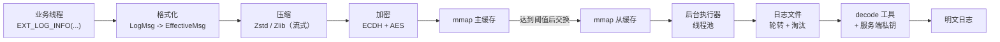

# 高性能跨平台异步日志库

[English](README.md) | 简体中文

> 面向服务端的 C++17 异步日志库：业务线程只写内存、不碰磁盘，压缩、加密与落盘全部后台化；落盘数据自带完整性校验与端到端加密，可通过配套解码器离线还原。


## 设计目标

| 目标 | 实现手段 |
| --- | --- |
| 前台零磁盘 IO | 业务线程只做格式化与追加内存，压缩 / 加密 / 写盘由后台执行器完成 |
| 写入不阻塞业务 | 主从双缓冲 + mmap，缓存利用率达阈值后原子交换 |
| 多线程可扩展 | 压缩器每线程 `Clone()`、压缩/加密缓冲 `thread_local`，热路径只剩写缓存 |
| 落盘体积可控 | 按条流式压缩，Zstd / Zlib 可切换；小日志可挂训练字典 |
| 数据不可明文落盘 | 每个 chunk 用 ECDH 协商密钥，负载 AES 加密，私钥只存在于解码端 |
| 跨平台行为一致 | POSIX / Win32 差异层统一 mmap、文件与系统工具接口 |

## 特性

- **异步非阻塞写入**：业务线程只做格式化和向 mmap 缓存追加，压缩、加密、落盘全部交给后台执行器。
- **mmap 双缓冲持久化**：主缓存使用率超过阈值时与从缓存交换，前台继续写新主缓存，后台线程把从缓存写盘。
- **多线程可扩展**：压缩/加密不再共用一把全局锁，压缩器按线程克隆；8 线程吞吐约 1.8×，P99 从毫秒级降到百微秒级。
- **流式压缩**：按条流式压缩，支持 Zstd / Zlib；压缩上下文和输入输出缓冲复用，避免反复分配。
- **可选字典压缩**：`Conf::dict_path` 挂载训练好的 zstd 字典，缓解小日志落盘膨胀。
- **端到端加密**：每个 chunk 通过 ECDH 协商密钥，日志负载使用 AES 加密，私钥只存在于解码端。
- **Protobuf 记录编码**：级别、时间戳、pid、tid、文件名、函数名、行号、消息体按 `.proto` 结构化序列化，解码时可自定义输出格式。
- **插件化架构**：Sink、Formatter、Compressor、Cryptor 均面向抽象接口，可替换实现。
- **日志轮转与淘汰**：按单文件大小轮转，目录总容量超限时删除最旧文件（永远保留最新一个），并周期性清理。
- **编译期级别裁剪**：被禁用的日志级别展开为 `(void)0`，运行时零开销。
- **跨平台**：POSIX / Win32 平台差异层，统一 mmap、文件与系统工具接口。
- **离线解码工具**：把二进制日志还原为可读文本，支持自定义格式串与可选字典。

## 架构



写入流程：

1. `EXT_LOG_*` 宏 / `LogHandle::Log` 先按级别过滤，再用 `fmt` 完成格式化。
2. `EffectiveSink` 把日志序列化为 Protobuf，流式压缩，再用 ECDH 派生出的 AES 密钥加密。
3. 加密后的记录以 `ItemHeader + payload` 的形式追加到 mmap **主缓存**。
4. 主缓存超过利用率阈值时交换主从缓存，后台执行器把从缓存写入磁盘。
5. 按 `single_size` 轮转文件；总大小超过 `total_size` 时删除最旧的文件，但永远保留最新一个。

### 落盘格式

```text
ChunkHeader                                      ItemHeader        payload
+----------------+----------------+-------------+ +-----------+----+ +-------------------+
| magic (8B)     | size (8B)      | pub_key     | | magic 4B  | sz | | AES 密文          |
| 0xdeadbeef...  | 负载字节数     | (128B)      | | size 4B   |    | | (zstd/zlib 数据)  |
+----------------+----------------+-------------+ +-----------+----+ +-------------------+
```

每个 chunk 都携带客户端临时公钥，解码端用服务端私钥即可派生出相同密钥，因此日志文件可以离线解码。

## 关键设计取舍

| 决策点 | 选择 | 代价 | 理由 |
| --- | --- | --- | --- |
| 缓存介质 | mmap 映射 + 顺序追加 | 需要自行管理文件大小与缺页 | 省去 `write` 的用户态→内核态拷贝，写入只落 page cache 由内核回刷 |
| 缓冲策略 | 主从双缓冲交换 | 交换瞬间需短暂互斥 | 前台写入与后台落盘彻底解耦，避免业务线程等待磁盘 |
| 并发模型 | 压缩器每线程克隆 + `thread_local` 缓冲 | 每线程一份压缩上下文（约百 KB 级） | 把压缩/加密移出全局锁，P99 从毫秒级回到百微秒级 |
| 压缩粒度 | 按条压缩 | 每帧有固定头开销，小日志收益低 | 单条可独立解压，支持随机读取与损坏隔离 |
| 加密顺序 | 先压缩后加密 | —— | 加密后数据无冗余，顺序颠倒会导致压缩失效 |
| 记录编码 | Protobuf 二进制 | 需配套 `.proto` 与解码器 | 字段自描述、可扩展，体积远小于文本格式 |
| 级别过滤 | 编译期裁剪 | 需在构建时确定级别 | 被裁掉的日志不会产生任何运行时开销 |

## 构建

前置条件：

- CMake 3.20+
- 支持 C++17 的编译器（Visual Studio 2022 / GCC / Clang）
- Python 3
- Windows 需要 Visual Studio 2022 与 `v143` 工具集

所有依赖都已放在 `logger/third_party/`，构建不需要联网：

| 库 | 版本 |
| --- | --- |
| zstd | 1.5.8 |
| zlib | 1.3.1.1 |
| protobuf | 6.34.0 |
| abseil | 20250512.1 |
| cryptopp | 8.9.0 |
| fmt | 12.0.0 |

### Windows

```powershell
python script/build_windows.py
```

默认 Debug 配置，产物位于：

```text
build/x64-Debug/logger/Debug/logger.lib
build/x64-Debug/example/Debug/logger_example.exe
build/x64-Debug/example/Debug/macro_logger_example.exe
build/x64-Debug/example/Debug/crypt_example.exe
build/x64-Debug/example/Debug/zstd_example.exe
build/x64-Debug/decode/Debug/decoder.exe
```

### Linux

```bash
python3 script/build_linux.py
```

> `script/bin/protoc` 是预编译的 x86-64 Linux 可执行文件，用于在 CMake 之前生成 `effective_msg.pb.*`。其他架构请替换为对应平台的 `protoc`。

### 压测工具

`bench/` 下三个可执行文件用于复现性能数据（构建方式见 [bench/RESULTS.md](bench/RESULTS.md)）：

| 目标 | 作用 |
| --- | --- |
| `bench_logger` | 端到端压测：线程数 / 条数 / 载荷大小 / `random` 或 `template` / `--dict` / `--no-flush` |
| `micro_bench` | 把 `Log()` 拆成 IV、AES、zstd、protobuf 四段单独计时 |
| `retention_test` | 淘汰逻辑验证，含 `total_size <= single_size` 的边界场景 |

## 快速开始

```cpp
#include "logger/logger.h"
#include "logger/sinks/effective_sink.h"

int main() {
  logger::EffectiveSink::Conf conf;
  conf.dir = "./logs";                       // 输出目录
  conf.prefix = "app";                       // 文件名前缀
  conf.pub_key = "<服务端公钥 hex>";         // 解码端的 ECDH 公钥
  conf.single_size = logger::megabytes{4};   // 单文件 4 MB 轮转
  conf.total_size = logger::megabytes{100};  // 目录最多保留 100 MB
  conf.interval = std::chrono::minutes{5};   // 清理周期
  conf.dict_path = "";                       // 可选：zstd 字典文件，留空表示不启用

  auto sink = std::make_shared<logger::EffectiveSink>(conf);
  auto handle = std::make_shared<logger::VariadicLogHandle>(sink);
  EXT_LOGGER_INIT(handle);  // 安装全局句柄

  EXT_LOG_INFO("server started, port={}", 8080);
  EXT_LOG_WARN("slow request: {} ms", 350);
  EXT_LOG_ERROR("request failed: {}", "timeout");

  sink->Flush();  // 同步刷出当前缓存（析构时也会自动 Flush）
  return 0;
}
```

说明：

- `EXT_LOG_*` 使用 `EXT_LOGGER_INIT` 安装的全局句柄，也可以直接调用 `handle->Log(...)`。
- `ConsoleSink` 可以和 `EffectiveSink` 组合使用，`LogHandle` 支持同时挂载多个 Sink。
- 日志级别通过 `LOGGER_ACTIVE_LEVEL` 在编译期裁剪（默认全部开启）。例如定义为 `LOGGER_LEVEL_WARN` 后，低级别调用会直接从二进制中消失。
- 高频内部日志（如每次落盘打印文件路径）默认关闭，排查时加 `-DLOGGER_INTERNAL_VERBOSE` 打开。

### CMake 集成

```cmake
add_subdirectory(path/to/high-performance-logger)

add_executable(app main.cc)
target_link_libraries(app PRIVATE logger)
target_include_directories(app PRIVATE path/to/high-performance-logger)
target_compile_definitions(app PRIVATE FMT_HEADER_ONLY=1)
```

## 生成密钥与解码日志

`crypt_example` 会打印一组 ECDH 密钥对和一个 AES 示例密钥：

```bash
./crypt_example
# server_pri_hex: ...
# server_pub_hex: ...
```

把 `server_pub_hex` 填入 `EffectiveSink::Conf::pub_key`，`server_pri_hex` 只保存在解码端。

解码日志文件：

```bash
./decoder <日志文件> <服务端私钥hex> <输出文本文件> [字典文件]
```

解码流程为：校验 chunk 头 → 用内嵌的客户端公钥做 ECDH → AES 解密 → Zstd 解压 → Protobuf 反序列化 → 按格式串输出。格式串在 `decode/decode.cc` 中设置，例如 `[%l][%D:%S][%p:%t][%F:%f:%#]%v`。写入时若启用了字典，解码需传入同一份字典文件。

## 性能与压缩率

### 测试环境

| 项 | 值 |
| --- | --- |
| CPU | AMD Ryzen 7 7745HX（8 核 16 线程） |
| 内存 / 系统 | 16 GB / Windows 11 |
| 编译器 | MinGW-w64 g++ 13.2.0，`-O3 -DNDEBUG` |
| 磁盘 | SSD |

### 测量口径

- 计时只包住 `Log()` 调用本身，**不含**最后的 `Flush()`——这才是业务线程被阻塞的时间。
- 吞吐 = 总条数 / 所有线程跑完的时间；多线程为**聚合**吞吐。
- 延迟按每条 `Log()` 的耗时统计 P50 / P99。
- 体积下降为**端到端**口径：含 Protobuf 字段、Zstd 帧头、IV、AES 填充与 ItemHeader。
- 单线程同一配置在 28k ~ 46k 之间波动（磁盘回写竞争与笔记本热降频），引用时取区间或保守值。

### 当前结果

| 场景 | 吞吐 | P50 | P99 |
| --- | --- | --- | --- |
| 8 线程 · 200 B 业务日志 | **256,136 条/s** | 26 µs | 62 µs |
| 8 线程 · 2 KB 业务日志 | **123,597 ~ 127,356 条/s** | 38 µs | 106 ~ 109 µs |
| 8 线程 · 2 KB 随机串 | 62,501 条/s | 42 µs | 203 µs |
| 单线程 · 2 KB 业务日志 | 36,161 条/s | 26 µs | 42 µs |

一句话结论：**8 线程、2 KB 业务日志实测 12.4 万条/秒；单线程 3.6 万；不可压缩内容 8 线程 6.2 万。** 三个数要一起说——瓶颈已经从锁转移到磁盘写入带宽。

### 关键优化：把压缩/加密移出全局锁

| 配置 | 优化前 | 优化后 |
| --- | --- | --- |
| 8 线程 · 2 KB 随机串 | 30.5k ~ 36.2k 条/s，P99 **4.3 ~ 7.0 ms** | 58k ~ 63k 条/s，P99 **203 ~ 291 µs** |

吞吐约 1.8×，P99 降低约 20 倍。改法：压缩器接口增加 `Clone()`，`Log()` 内压缩器与两个缓冲改为 `thread_local`，临界区只剩 `WirteToCache_` 与利用率判断，缓存交换用 `compare_exchange_strong` 抢占。

### 微基准：定位到 CSPRNG

| 环节 | 修复前 | 修复后 |
| --- | --- | --- |
| GenerateIV | 123.06 µs | 0.26 µs |
| AES 加密（含 IV） | 133.96 µs | 5.07 µs |
| Zstd 压缩（level 5） | 1.17 µs | 1.17 µs |
| Protobuf 序列化 | 0.15 µs | 0.15 µs |

根因是每次加密都构造一个 `CryptoPP::AutoSeededRandomPool`，而构造它会初始化系统熵池。改为静态单例后，单线程 2 KB 随机串从 5,778 条/s 提升到 3.5 万 ~ 4.5 万条/s（6 ~ 7.7×）。

### 压缩率与字典

| 配置 | 无字典 | 有字典（16 KB 训练字典） |
| --- | --- | --- |
| 2 KB 业务日志 | 下降 67.6% | 下降 69.9% |
| 200 B 业务日志 | **膨胀 32.1%** | 下降 24.0% |
| 100 B 业务日志 | 膨胀 84.1% | 膨胀 36.1% |

- 2 KB 量级端到端下降约 68%。压缩器内部（输入→输出）在高重复样本上可达约 90%，差额来自 Protobuf 字段头、帧头、IV 与 AES 填充。
- 200 B 以下固定开销占比过高：挂上 `Conf::dict_path` 后由膨胀转为压缩；100 B 仍膨胀，要根治只能改格式（多条记录合帧，或整块共用一个 IV）。
- 字典属于部署约定：写入端与 `decoder` 必须加载同一份字典文件。

### 复现

```bash
cd build/mingw-release
cmake ../.. -G Ninja -DCMAKE_BUILD_TYPE=Release \
      -DCMAKE_C_COMPILER=gcc -DCMAKE_CXX_COMPILER=g++ \
      -Dprotobuf_BUILD_TESTS=OFF -DZLIB_BUILD_TESTING=OFF
cmake --build . --target bench_logger micro_bench retention_test -j 16

./bench/bench_logger.exe --threads 8 --records 240000 --size 2048 --mode template --dir bench_logs
./bench/bench_logger.exe --threads 8 --records 1000000 --size 200 --mode template --dir bench_logs
./bench/micro_bench.exe
./bench/retention_test.exe
```

完整的参数、波动区间与对比数据见 [bench/RESULTS.md](bench/RESULTS.md)。

> `logger_example` 使用随机字符串作为负载，用于压测写入路径本身；随机数据几乎无冗余，不适合评估压缩收益。

## 目录结构

```text
.
├── CMakeLists.txt
├── logger/                      # 核心静态库
│   ├── logger.h                 # EXT_LOG_* 宏
│   ├── log_handle.h             # 级别过滤 + 多 Sink 分发
│   ├── log_variadic_handle.h    # 基于 fmt 的可变参 Log()
│   ├── log_factory.h            # 全局句柄单例
│   ├── log_msg.h                # 日志消息模型
│   ├── internal_log.h           # 内部诊断日志（LOG_VERBOSE 默认关）
│   ├── compress/                # Zstd / Zlib 压缩（支持 Clone 与字典）
│   ├── context/                 # 执行器与线程池
│   ├── crypt/                   # ECDH + AES
│   ├── formatter/               # 文本与 Protobuf 格式化
│   ├── mmap/                    # mmap 缓存（POSIX / Win32）
│   ├── sinks/                   # 控制台与持久化 Sink
│   ├── utils/                   # 系统与文件工具
│   ├── proto/effective_msg.proto
│   └── third_party/             # 第三方依赖源码
├── example/                     # 可运行示例
├── bench/                       # 压测、微基准、淘汰验证与结果记录
├── decode/                      # 离线解码工具
└── script/                      # 构建脚本与内置 protoc
```

## 已知限制

- 日志格式为自定义二进制格式，必须使用配套解码器和服务端私钥才能还原。
- 解码器目前是单线程，并会把整个文件读入内存。
- 内置的 `protoc` 与平台绑定（Windows `protoc.exe`、Linux x86-64 `protoc`）。
- 100 B 以下记录因固定开销（IV、AES 填充、帧头）端到端仍会膨胀。
- 启用字典后，写入端与解码端必须使用同一份字典文件。
- 单线程吞吐存在明显测量波动，跨会话对比需交替 A/B。

## 后续优化

- 小记录合帧或整块共用一个 IV，消除百字节量级的膨胀。
- 解码器改为流式解析，支持大文件与并发解码。
- 把 `bench/` 纳入 CI，对吞吐与 P99 做回归门禁。

## 许可证

[MIT](LICENSE)
